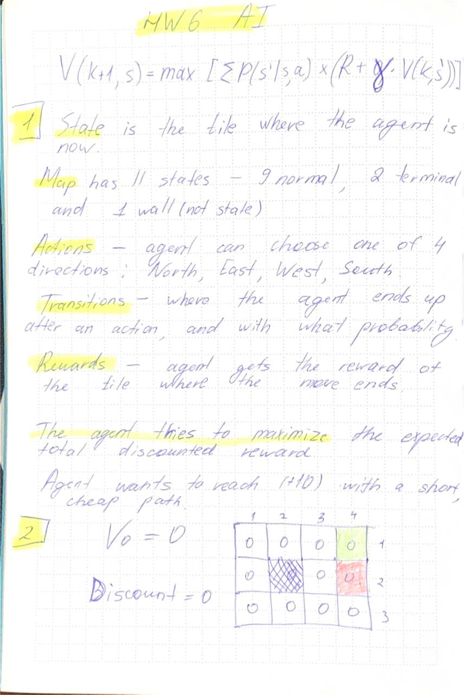
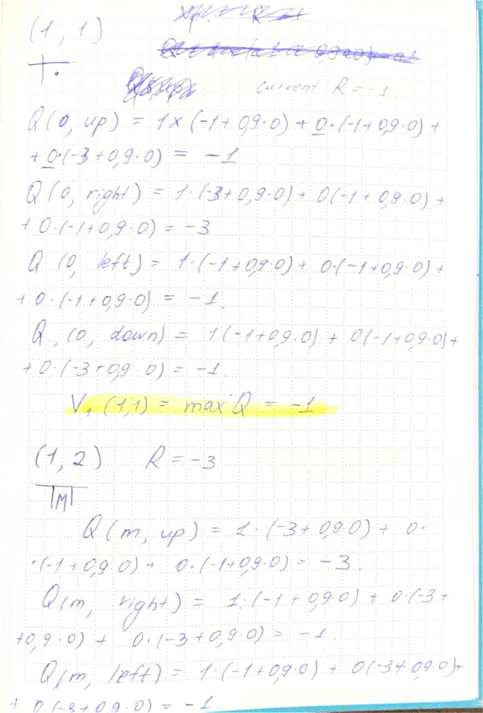
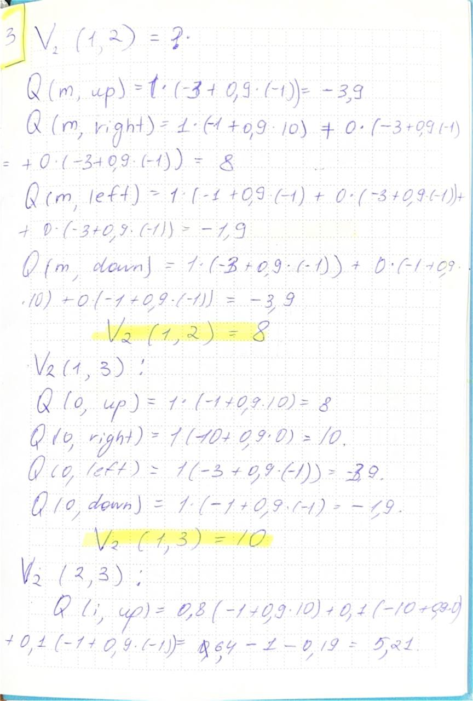

# HW6 submission

## AI-use declaration

I used Claude as a study helper.

## Setup and reproduction

Record dependency versions, installation commands and exact run commands.

## Part A — Paper calculations








## Part B — FrozenLake

### Fixed policy, written before the experiments

### Fixed policy, written before the experiments

```
 0 S   1 F   2 F   3 F
 4 F   5 H   6 F   7 H
 8 F   9 F  10 F  11 H
12 H  13 F  14 F  15 G
```

Actions: 0 = left, 1 = down, 2 = right, 3 = up.

| State | Action | Reason |
| --- | --- | --- |
| 0 | down | Start of the shortest path. Side slips go to 0 or 1, both safe. |
| 1 | left | Down is hole 5. Left goes back to 0. |
| 2 | down | Goes to 6 → 10 → 14. Side slips go to 1 or 3, both safe. |
| 3 | left | Down is hole 7. Left goes to 2. |
| 4 | down | The only move forward on the path. |
| 6 | down | The only move forward (holes on the left and right). |
| 8 | right | Down is hole 12. Right goes to 9. |
| 9 | down | Right also leads to the goal, but a side slip up would fall into hole 5. With down, side slips go to 8 or 10, both safe. |
| 10 | down | Goes to 14, next to the goal. |
| 13 | right | Goes to 14. Side slips go to 9 or stay in 13, both safe. |
| 14 | right | Goes directly to the goal. |

**Idea:** follow the shortest path 0 → 4 → 8 → 9 → 13 → 14 → 15. When two actions are equally short, I choose the one whose side slips do not lead into a hole. Off-path states send the agent back to the path. The policy depends only on the current state. I use the same policy in all experiments and do not change it.

### Results

| Slippery? | Policy | Batch seed | Goals /50 | Holes /50 | Time limits /50 | Success % | Mean steps |
| --- | --- | --- | --- | --- | --- | --- | --- |

Link episode rows and example traces in outputs/. Explain slipping, variation across batches and why these runs do not train a policy.

## Part C — Custom solver

### Compare code with paper

Show V1 and the requested V2 values. Explain discrepancies.

### Values, policies and convergence

Link both value/policy maps. Record iteration counts, final value changes and tie-breaking rule.

### Simulation results

| Map | Batch seed | Goals /50 | Holes /50 | Time limits /50 | Mean steps | Mean discounted return |
| --- | --- | --- | --- | --- | --- | --- |

### Explain your results

Which values/actions changed with sand and water? Where did cost and risk matter? How do simulations relate to the computed values?

### Rule checks

Show boundary/wall behavior, slip probabilities, floor rewards and terminal handling.

