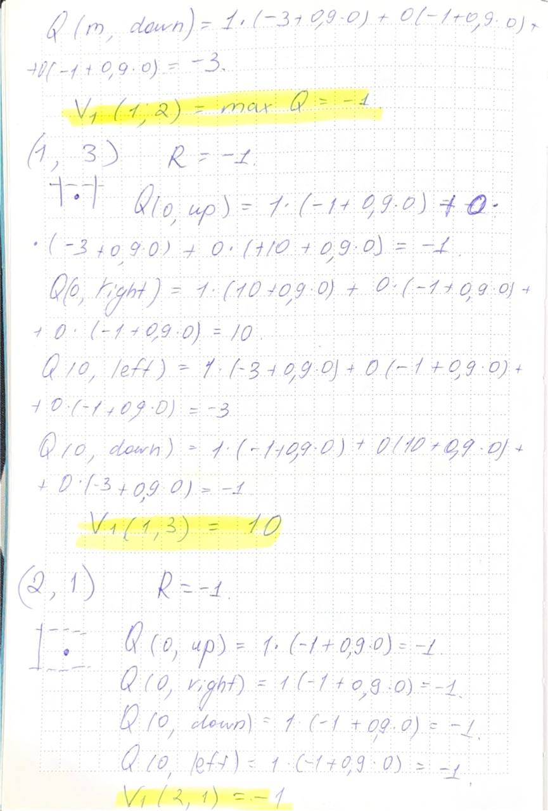
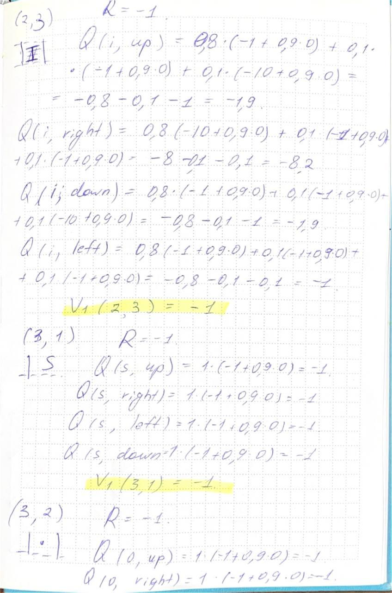
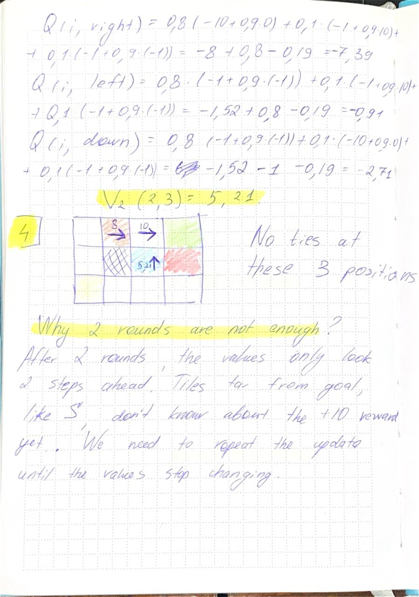

# HW6 submission

## AI-use declaration

I used Claude as a study helper.

## Setup and reproduction

- Python 3.11.9
- Gymnasium 1.4.0 

```
python -m venv .venv
.venv\Scripts\activate
pip install -r requirements.txt
python partB/experiment.py
```

## Part A — Paper calculations









## Part B — FrozenLake

### Fixed policy, written before the experiments

### Fixed policy, written before the experiments

```
 0 S   1 F   2 F   3 F
 4 F   5 H   6 F   7 H
 8 F   9 F  10 F  11 H
12 H  13 F  14 F  15 G
```

Actions: 0 = left, 1 = down, 2 = right, 3 = up.

| State | Action | Reason |
| --- | --- | --- |
| 0 | down | Start of the shortest path. Side slips go to 0 or 1, both safe. |
| 1 | left | Down is hole 5. Left goes back to 0. |
| 2 | down | Goes to 6 → 10 → 14. Side slips go to 1 or 3, both safe. |
| 3 | left | Down is hole 7. Left goes to 2. |
| 4 | down | The only move forward on the path. |
| 6 | down | The only move forward (holes on the left and right). |
| 8 | right | Down is hole 12. Right goes to 9. |
| 9 | down | Right also leads to the goal, but a side slip up would fall into hole 5. With down, side slips go to 8 or 10, both safe. |
| 10 | down | Goes to 14, next to the goal. |
| 13 | right | Goes to 14. Side slips go to 9 or stay in 13, both safe. |
| 14 | right | Goes directly to the goal. |

**Idea:** follow the shortest path 0 → 4 → 8 → 9 → 13 → 14 → 15. When two actions are equally short, I choose the one whose side slips do not lead into a hole. Off-path states send the agent back to the path. The policy depends only on the current state. I use the same policy in all experiments and do not change it.

### Results

| Slippery? | Policy | Batch seed | Goals /50 | Holes /50 | Time limits /50 | Success % | Mean steps |
| --- | --- | --- | --- | --- | --- | --- | --- |
| No | random | 11 | 2 | 48 | 0 | 4.0 | 9.78 |
| No | random | 22 | 0 | 50 | 0 | 0.0 | 6.9 |
| No | random | 33 | 0 | 50 | 0 | 0.0 | 7.44 |
| No | fixed | 11 | 50 | 0 | 0 | 100.0 | 6.0 |
| No | fixed | 22 | 50 | 0 | 0 | 100.0 | 6.0 |
| No | fixed | 33 | 50 | 0 | 0 | 100.0 | 6.0 |
| Yes | random | 11 | 0 | 50 | 0 | 0.0 | 8.44 |
| Yes | random | 22 | 1 | 49 | 0 | 2.0 | 7.76 |
| Yes | random | 33 | 0 | 50 | 0 | 0.0 | 7.3 |
| Yes | fixed | 11 | 1 | 49 | 0 | 2.0 | 5.22 |
| Yes | fixed | 22 | 2 | 48 | 0 | 4.0 | 6.0 |
| Yes | fixed | 33 | 1 | 49 | 0 | 2.0 | 5.14 |

**Totals over 150 episodes per condition:**

| Slippery? | Policy | Goals /150 | Success % |
| --- | --- | --- | --- |
| No | random | 2 | 1.3 |
| No | fixed | 150 | 100.0 |
| Yes | random | 1 | 0.7 |
| Yes | fixed | 4 | 2.7 |

**Files:**
- All 600 episode rows: [outputs/partB_episodes.csv](outputs/partB_episodes.csv)
- Summary: [outputs/partB_summary.csv](outputs/partB_summary.csv), [outputs/partB_summary.md](outputs/partB_summary.md)
- One episode with text rendering: [outputs/partB_example_episode.txt](outputs/partB_example_episode.txt)
- Successful trace: [outputs/partB_trace_success.txt](outputs/partB_trace_success.txt)
- Failed trace: [outputs/partB_trace_fail.txt](outputs/partB_trace_fail.txt)

Note: in the text files, `[41m` and `[0m` are terminal colour codes. Gymnasium uses them to show the agent's position in red.

**What slipping changed**

Without slipping, my fixed policy reached the goal in all 150 episodes, always in exactly 6 steps (0 → 4 → 8 → 9 → 13 → 14 → 15). Every move was deterministic, so every episode was the same.

With slipping, the agent moves in the chosen direction only with probability 1/3, and to each side with probability 1/3. My shortest path goes next to holes (states 4, 6, 8, 10, and also 1 and 3 when the agent slips off the path). Success fell to 4 of 150 episodes (2.7%). Many episodes ended in a hole after only 2–4 steps. For example, from state 0 the agent slips right to state 1, then slips down into hole 5. This is why the mean steps are small: the agent dies quickly. The 4 successful slippery episodes took 10–23 steps instead of 6, because slips pushed the agent off the path and it had to come back.

I also calculated the exact success probability of my fixed policy in the slippery environment (using the transition probabilities, within 100 steps). It is 1/24 ≈ 4.2%. My observed 2.7% is close to this value. The difference is normal for only 150 episodes.

The random policy was bad in both modes (2/150 without slipping, 1/150 with slipping). With slipping, my fixed policy was only a little better than random. It was designed for the shortest path, not for safety. So it is not a good policy for the slippery case.

No episode reached the 100-step time limit. All 600 episodes ended in a goal or a hole.

**How consistent the batches were**

Without slipping, the fixed policy gave exactly the same result in all three batches (50/50, 6.0 steps), because nothing is random. In the other conditions, the batches were similar but not equal: 0 to 2 goals per batch. With only 50 episodes, one lucky episode changes the success rate by 2 percentage points. So the differences between batches (for example 2% vs 4%) are random noise, not a real difference between seeds.

**Why one successful episode is not enough evidence**

The random policy reached the goal 3 times in total. For example, episode seed 11009 (no slipping) reached the goal in 22 steps after moving back and forth. If we looked only at this episode, we could think the random policy works. But over 150 episodes, it succeeded only 1.3% of the time. In the same way, the fixed policy succeeded 4 times with slipping, but failed 146 times. We need many episodes and several seeds to estimate the real success rate.

**Example traces**

- Successful trace: random policy, no slipping, batch 11, episode seed 11009. The agent moved randomly between states 0, 1 and 2, then went down to 8, right to 10, went up and down between 6 and 10 several times, and finally went 10 → 14 → 15 (goal) in 22 steps. This success was luck.
- Failed trace (also the example episode with text rendering): random policy, no slipping, batch 11, episode seed 11000. The agent pressed "up" three times at the start and stayed in state 0 (the edge of the map). Then it moved between 4 and 8, and at step 10 it moved right from state 4 into hole 5.
- Successful slippery episodes for the fixed policy were also observed (episode seeds 11020, 22029, 22046 and 33041). Their rows are in the CSV file.

**Why these simulations are not training**

The fixed policy is the same table in every episode. The random policy always chooses actions randomly. After each episode, nothing is updated: no values, no Q-table, no change in the policy. The agent does not learn from rewards. We only measure how well two policies that do not change perform. Training would mean that the agent uses its experience to change its policy, for example with Q-learning.

## Part C — Custom solver

Run: `python partC/main.py` (only the Python standard library is used).

### Compare code with paper

Full comparison: [outputs/partC_paper_compare.txt](outputs/partC_paper_compare.txt)

V1 from the code:

```
|   -1.00|   -1.00|   10.00|     G=0|
|   -1.00|       #|   -1.00|     H=0|
|   -1.00|   -1.00|   -1.00|   -1.00|
```

| Position | up | right | down | left | V2 (code) | V2 (paper) |
| --- | --- | --- | --- | --- | --- | --- |
| (1,2) Mud | -3.9 | **8.0** | -3.9 | -1.9 | 8.0 | 8.0 |
| (1,3) | 8.0 | **10.0** | -1.9 | -3.9 | 10.0 | 10.0 |
| (2,3) Ice | **5.21** | -7.39 | -2.71 | -0.91 | 5.21 | 5.21 |

All V1 values and all twelve Q-values for V2 match my paper work exactly. There were no discrepancies, so no corrections were needed.

### Values, policies and convergence

- Original map: [outputs/partC_paper_map.txt](outputs/partC_paper_map.txt)
- Extended map: [outputs/partC_extended_map.txt](outputs/partC_extended_map.txt)

| Map | Iterations | Final max change | Converged? |
| --- | --- | --- | --- |
| Original | 12 | 2.165e-07 | Yes |
| Extended | 11 | 2.406e-07 | Yes |

The safeguard of 10,000 iterations was never reached.

**Original map** (`.M.G / .#IH / S...`):

```
Values                                      Policy
|  4.2000|  8.0000| 10.0000|    G=0|        | .→ | M→ | .→ | G  |
|  2.7800|       #|  5.8242|    H=0|        | .↑ | #  | I↑ | H  |
|  1.5358|  2.8176|  4.2418| 2.8176|        | S→ | .→ | .↑ | .← |
```

**Extended map** (`.M.G / .#IH / SD.W`):

```
Values                                      Policy
|  4.2000|  8.0000| 10.0000|    G=0|        | .→ | M→ | .→ | G  |
|  2.7800|       #|  5.8242|    H=0|        | .↑ | #  | I↑ | H  |
|  1.5020|  2.8176|  4.2418| 2.8176|        | S↑ | D→ | .↑ | W← |
```

**Tie-breaking rule:** two actions are tied if their Q-values differ by less than 1e-9. All tied actions are listed in the output files. The chosen arrow is the first tied action in the order up, right, down, left. In my results, no ties were found on either map, so the rule did not change any arrow.

The policy was extracted by computing the Q-value of all four actions in every state using the final values, and choosing the largest.

### Simulation results

Episodes: [outputs/partC_episodes.csv](outputs/partC_episodes.csv) (each row includes the path). Summary: [outputs/partC_summary.csv](outputs/partC_summary.csv)

| Map | Batch seed | Goals /50 | Holes /50 | Time limits /50 | Mean steps | Mean discounted return |
| --- | --- | --- | --- | --- | --- | --- |
| original | 11 | 42 | 8 | 0 | 4.98 | 0.8913 |
| original | 22 | 46 | 4 | 0 | 5.04 | 1.9148 |
| original | 33 | 48 | 2 | 0 | 5.04 | 2.4921 |
| extended | 11 | 50 | 0 | 0 | 5.0 | 1.502 |
| extended | 22 | 50 | 0 | 0 | 5.0 | 1.502 |
| extended | 33 | 50 | 0 | 0 | 5.0 | 1.502 |

V(S) on the original map = 1.5358. V(S) on the extended map = 1.5020.

Each episode starts at S, uses the computed policy, stops at G or H or after 100 steps, and uses seed `1000 × batch_seed + i`. The discounted return is `r0 + 0.9*r1 + 0.9^2*r2 + ...`.

### Explain your results

**Which values and actions changed with sand and water?**

Only one action changed: at S, the best action changed from **right** (original) to **up** (extended).

- On the original map, the best path is S → (3,2) → (3,3) → ice → (1,3) → G.
- On the extended map, (3,2) is sand (-2 instead of -1). Q(S, right) dropped from 1.5358 to 0.5358, which is exactly 1 lower because of the extra sand cost. Now the upper path S → (2,1) → (1,1) → Mud → (1,3) → G is better: Q(S, up) = 1.5020.
- Because the best action at S changed, V(S) dropped from 1.5358 to 1.5020. Q(2,1, down), which goes into S, also changed (0.3822 → 0.3518).

All other values stayed the same. The values of the sand and water tiles themselves (2.8176) are equal to the values of the floor tiles at the same places on the original map. This is because the reward is paid when the agent **enters** a tile. The cost of sand and water appears in the Q-values of moves **into** these tiles:
- moving into sand from S: Q = 0.5358 instead of 1.5358 (1 lower);
- moving into water from (3,3): Q = -2.4642 instead of 1.5358 (4 lower).

The policy never moves into sand or water. If the agent starts on water, it leaves to the left.

**Where did cost and risk matter?**

- **Cost:** the upper path goes through mud (-3), but on the extended map it is still better than paying for sand. On the original map, the two paths are very close (1.5358 vs 1.5020), so a small extra cost of 1 was enough to change the choice.
- **Risk (ice):** on the original map, the best path goes over ice. From ice, the policy chooses **up** (Q = 5.8242). This moves to (1,3) with probability 0.8, but falls into the hole with probability 0.1. The safe action **left** (into the wall) only gives 4.4752, because the agent stays on ice and does not make progress. Value iteration maximises the **expected** return, so it accepts the 10% risk because (1,3) is very valuable (8.0 one step from the goal). It never chooses **right** (Q = -6.9182, 80% hole).
- On the extended map, the agent avoids the ice completely. The reason is the sand cost, not the ice risk, but as a result its path has no risk at all.

**How do simulations relate to the computed values?**

V(S) is the **expected** discounted return over an **infinite** horizon, computed exactly from the model. A simulation gives only a **finite** number of sample episodes, each cut at 100 steps. So the simulation **estimates** V(S); it is not identical to it.

- **Extended map:** the path has no ice, so every episode is the same: 5 steps, return exactly 1.502 = V(S). Here the simulation and the value match exactly, because there is no randomness.
- **Original map:** each episode either reaches the goal (return 3.122 in 5 steps, or 1.8098 if the agent slips once and stays on ice) or falls into the hole (return -10.0). The batch means were 0.89, 1.91 and 2.49. The mean of all 150 episodes is about 1.63, which is close to V(S) = 1.5358. One extra hole in a batch of 50 changes the mean by about 0.26, so the batches vary a lot.
- In theory, the hole probability with this policy is 0.1 / (0.1 + 0.8) ≈ 11.1% (the agent can stay on ice and try again). We observed 14/150 = 9.3%, which is close.
- The 100-step limit did not matter here: all episodes ended in 4–6 steps. In general, rewards after step 100 are multiplied by 0.9^100 ≈ 0.00003, so they are almost zero.

### Rule checks

Full output: [outputs/partC_rule_checks.txt](outputs/partC_rule_checks.txt) — **20/20 checks passed.**

- **Boundary:** S (3,1) left and (1,1) up stay in place with reward -1.
- **Wall:** Mud (1,2) down hits the wall and stays in mud with reward -3; (2,1) right stays with -1; the wall (2,2) is not a state (11 states total).
- **Ice probabilities:** for all four actions on ice, the probabilities sum to 1 (0.8 + 0.1 + 0.1). Ice left: 0.8 stay (wall), 0.1 up, 0.1 down.
- **Floor rewards:** entering mud gives -3, sand -2, water -5, goal +10, hole -10. Sand and water are deterministic.
- **Terminal handling:** G and H have no transitions; V(G) = V(H) = 0 after value iteration; a simulation from (1,3) moving right stops at G after 1 step with total reward exactly +10.