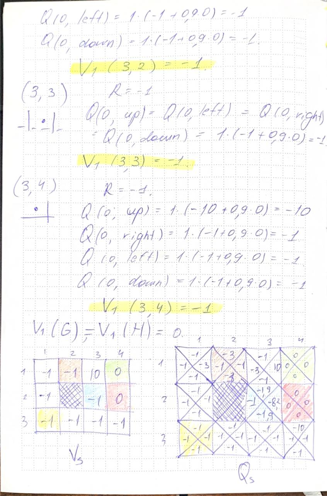

# HW6 submission

## AI-use declaration

I used Claude as a study helper.

## Setup and reproduction

- Python 3.11.9
- Gymnasium 1.4.0 

```
python -m venv .venv
.venv\Scripts\activate
pip install -r requirements.txt
python partB/experiment.py
```

## Part A — Paper calculations





## Part B — FrozenLake

### Fixed policy, written before the experiments

### Fixed policy, written before the experiments

```
 0 S   1 F   2 F   3 F
 4 F   5 H   6 F   7 H
 8 F   9 F  10 F  11 H
12 H  13 F  14 F  15 G
```

Actions: 0 = left, 1 = down, 2 = right, 3 = up.

| State | Action | Reason |
| --- | --- | --- |
| 0 | down | Start of the shortest path. Side slips go to 0 or 1, both safe. |
| 1 | left | Down is hole 5. Left goes back to 0. |
| 2 | down | Goes to 6 → 10 → 14. Side slips go to 1 or 3, both safe. |
| 3 | left | Down is hole 7. Left goes to 2. |
| 4 | down | The only move forward on the path. |
| 6 | down | The only move forward (holes on the left and right). |
| 8 | right | Down is hole 12. Right goes to 9. |
| 9 | down | Right also leads to the goal, but a side slip up would fall into hole 5. With down, side slips go to 8 or 10, both safe. |
| 10 | down | Goes to 14, next to the goal. |
| 13 | right | Goes to 14. Side slips go to 9 or stay in 13, both safe. |
| 14 | right | Goes directly to the goal. |

**Idea:** follow the shortest path 0 → 4 → 8 → 9 → 13 → 14 → 15. When two actions are equally short, I choose the one whose side slips do not lead into a hole. Off-path states send the agent back to the path. The policy depends only on the current state. I use the same policy in all experiments and do not change it.

### Results

| Slippery? | Policy | Batch seed | Goals /50 | Holes /50 | Time limits /50 | Success % | Mean steps |
| --- | --- | --- | --- | --- | --- | --- | --- |
| No | random | 11 | 2 | 48 | 0 | 4.0 | 9.78 |
| No | random | 22 | 0 | 50 | 0 | 0.0 | 6.9 |
| No | random | 33 | 0 | 50 | 0 | 0.0 | 7.44 |
| No | fixed | 11 | 50 | 0 | 0 | 100.0 | 6.0 |
| No | fixed | 22 | 50 | 0 | 0 | 100.0 | 6.0 |
| No | fixed | 33 | 50 | 0 | 0 | 100.0 | 6.0 |
| Yes | random | 11 | 0 | 50 | 0 | 0.0 | 8.44 |
| Yes | random | 22 | 1 | 49 | 0 | 2.0 | 7.76 |
| Yes | random | 33 | 0 | 50 | 0 | 0.0 | 7.3 |
| Yes | fixed | 11 | 1 | 49 | 0 | 2.0 | 5.22 |
| Yes | fixed | 22 | 2 | 48 | 0 | 4.0 | 6.0 |
| Yes | fixed | 33 | 1 | 49 | 0 | 2.0 | 5.14 |

**Totals over 150 episodes per condition:**

| Slippery? | Policy | Goals /150 | Success % |
| --- | --- | --- | --- |
| No | random | 2 | 1.3 |
| No | fixed | 150 | 100.0 |
| Yes | random | 1 | 0.7 |
| Yes | fixed | 4 | 2.7 |

**Files:**
- All 600 episode rows: [outputs/partB_episodes.csv](outputs/partB_episodes.csv)
- Summary: [outputs/partB_summary.csv](outputs/partB_summary.csv), [outputs/partB_summary.md](outputs/partB_summary.md)
- One episode with text rendering: [outputs/partB_example_episode.txt](outputs/partB_example_episode.txt)
- Successful trace: [outputs/partB_trace_success.txt](outputs/partB_trace_success.txt)
- Failed trace: [outputs/partB_trace_fail.txt](outputs/partB_trace_fail.txt)

Note: in the text files, `[41m` and `[0m` are terminal colour codes. Gymnasium uses them to show the agent's position in red.

**What slipping changed**

Without slipping, my fixed policy reached the goal in all 150 episodes, always in exactly 6 steps (0 → 4 → 8 → 9 → 13 → 14 → 15). Every move was deterministic, so every episode was the same.

With slipping, the agent moves in the chosen direction only with probability 1/3, and to each side with probability 1/3. My shortest path goes next to holes (states 4, 6, 8, 10, and also 1 and 3 when the agent slips off the path). Success fell to 4 of 150 episodes (2.7%). Many episodes ended in a hole after only 2–4 steps. For example, from state 0 the agent slips right to state 1, then slips down into hole 5. This is why the mean steps are small: the agent dies quickly. The 4 successful slippery episodes took 10–23 steps instead of 6, because slips pushed the agent off the path and it had to come back.

I also calculated the exact success probability of my fixed policy in the slippery environment (using the transition probabilities, within 100 steps). It is 1/24 ≈ 4.2%. My observed 2.7% is close to this value. The difference is normal for only 150 episodes.

The random policy was bad in both modes (2/150 without slipping, 1/150 with slipping). With slipping, my fixed policy was only a little better than random. It was designed for the shortest path, not for safety. So it is not a good policy for the slippery case.

No episode reached the 100-step time limit. All 600 episodes ended in a goal or a hole.

**How consistent the batches were**

Without slipping, the fixed policy gave exactly the same result in all three batches (50/50, 6.0 steps), because nothing is random. In the other conditions, the batches were similar but not equal: 0 to 2 goals per batch. With only 50 episodes, one lucky episode changes the success rate by 2 percentage points. So the differences between batches (for example 2% vs 4%) are random noise, not a real difference between seeds.

**Why one successful episode is not enough evidence**

The random policy reached the goal 3 times in total. For example, episode seed 11009 (no slipping) reached the goal in 22 steps after moving back and forth. If we looked only at this episode, we could think the random policy works. But over 150 episodes, it succeeded only 1.3% of the time. In the same way, the fixed policy succeeded 4 times with slipping, but failed 146 times. We need many episodes and several seeds to estimate the real success rate.

**Example traces**

- Successful trace: random policy, no slipping, batch 11, episode seed 11009. The agent moved randomly between states 0, 1 and 2, then went down to 8, right to 10, went up and down between 6 and 10 several times, and finally went 10 → 14 → 15 (goal) in 22 steps. This success was luck.
- Failed trace (also the example episode with text rendering): random policy, no slipping, batch 11, episode seed 11000. The agent pressed "up" three times at the start and stayed in state 0 (the edge of the map). Then it moved between 4 and 8, and at step 10 it moved right from state 4 into hole 5.
- Successful slippery episodes for the fixed policy were also observed (episode seeds 11020, 22029, 22046 and 33041). Their rows are in the CSV file.

**Why these simulations are not training**

The fixed policy is the same table in every episode. The random policy always chooses actions randomly. After each episode, nothing is updated: no values, no Q-table, no change in the policy. The agent does not learn from rewards. We only measure how well two policies that do not change perform. Training would mean that the agent uses its experience to change its policy, for example with Q-learning.

## Part C — Custom solver

### Compare code with paper

Show V1 and the requested V2 values. Explain discrepancies.

### Values, policies and convergence

Link both value/policy maps. Record iteration counts, final value changes and tie-breaking rule.

### Simulation results

| Map | Batch seed | Goals /50 | Holes /50 | Time limits /50 | Mean steps | Mean discounted return |
| --- | --- | --- | --- | --- | --- | --- |

### Explain your results

Which values/actions changed with sand and water? Where did cost and risk matter? How do simulations relate to the computed values?

### Rule checks

Show boundary/wall behavior, slip probabilities, floor rewards and terminal handling.

